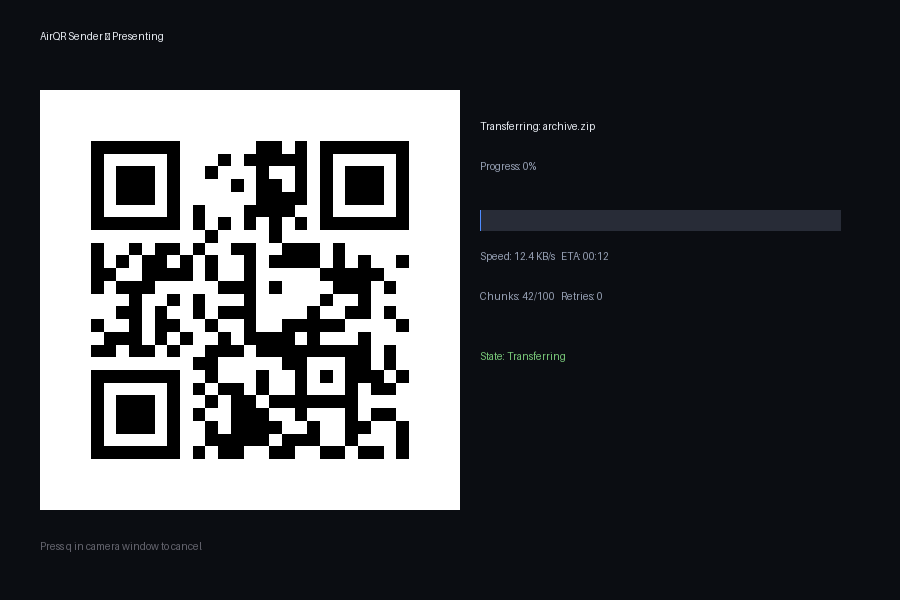
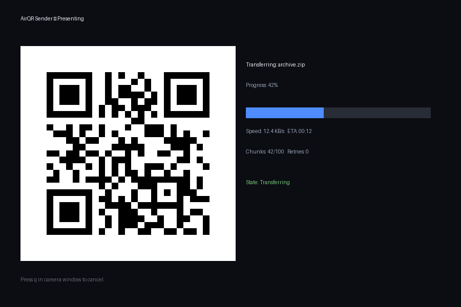

# AirQR — Offline QR-Code File Transfer



Transfer files between a PC and a phone (or PC↔PC) using only animated QR codes on the sender's screen and the receiver's camera. **No internet, Wi-Fi, Bluetooth, mobile data, cloud, account, pairing, or server required.**

## Features
- Fully offline binary protocol (chunked, CRC32 + SHA-256)
- Compression (Zstd, skips already-compressed media)
- AES-256-GCM + Argon2id encryption
- Reed-Solomon FEC + selective retransmission + resume
- Folder structure preservation
- PC CLI + Web PWA (mobile send & receive)
- Broadcast mode for laptop→mobile (no ACK)

## Install
```bash
pip install .
# or: pip install -e .
```

## Quick Start
```bash
# Receiver (PC)
airqr receive --dest ./downloads

# Sender (PC)
airqr send ./my_folder

# Laptop → Mobile (no ACK)
airqr send ./folder --web --broadcast
```

## Mobile (PWA)
```bash
python framework/run.py
```
Open `http://<PC-IP>:8765/index.html` on phone → **Add to Home screen**. Use Receive/Send tabs.

## Demo
 

## Docs
- [Usage](docs/usage.md) · [Protocol](docs/protocol.md) · [Architecture](docs/architecture.md) · [Troubleshooting](docs/troubleshooting.md) · [Install](docs/install.md) · [Competitive Research](docs/competitive_research.md)

## Requirements
Python 3.10+, webcam. See [install.md](docs/install.md). Status: v1 (Python) + web PWA. Native mobile apps on roadmap (PLAN.md).
